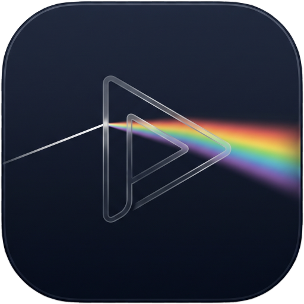
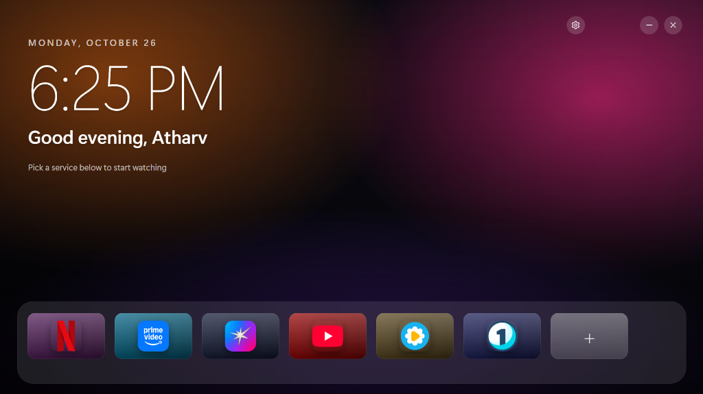
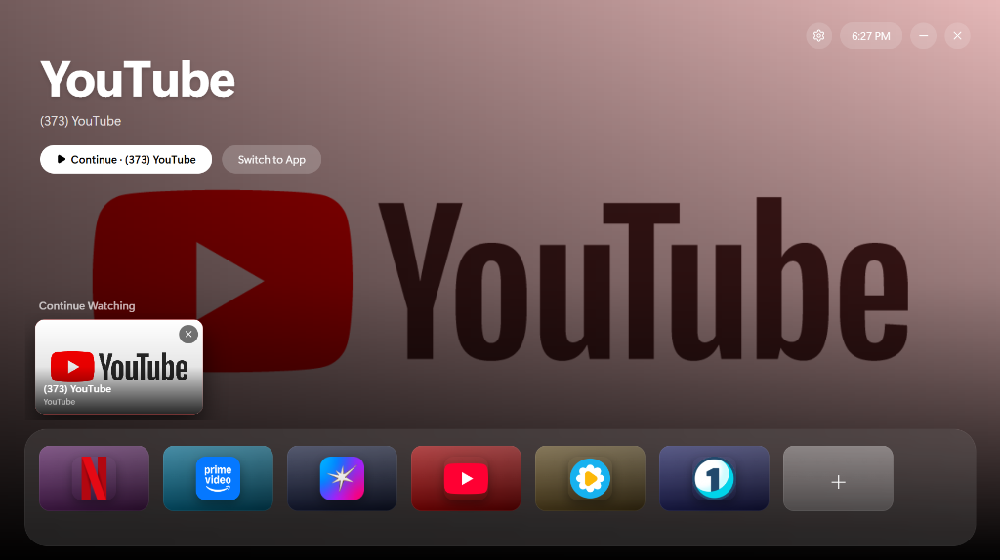
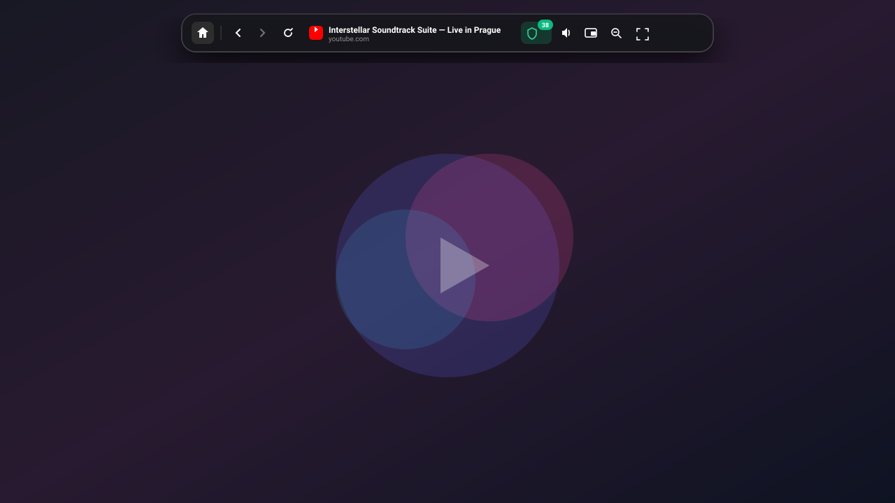
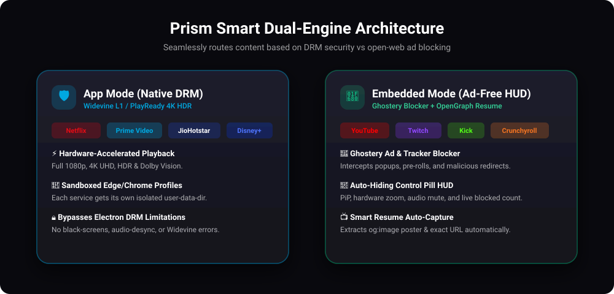

<div align="center">

  

  # Prism

  **A calm, tvOS-inspired streaming hub for your desktop.**

  <p align="center">
    <a href="https://github.com/Atharv62/Prism-launcher/releases"></a>
    
    
    
    
    
    <a href="LICENSE"></a>
  </p>

  <p align="center">
    <a href="#why-i-built-it">Why I Built It</a> •
    <a href="#ui-preview">UI Preview</a> •
    <a href="#how-it-works">How It Works</a> •
    <a href="#features">Features</a> •
    <a href="#shortcuts">Shortcuts</a> •
    <a href="#install">Install</a>
  </p>

  <br />

 </div>

> **Note:** Prism is a media launcher for PC streaming services (not affiliated with the Minecraft launcher).

---

## Why I Built It

Watching movies, anime, and streams on a PC is usually a mess:

- **Browser clutter:** Watching video in a browser means 40 open tabs, bookmarks, search bars, and notifications getting in the way.
- **Lost episodes:** Close your browser, and you lose your place. There is no unified "Continue Watching" across different streaming sites on desktop.
- **The DRM dilemma:** Playing DRM streams (Netflix, Prime Video, Disney+) inside embedded Electron apps either fails completely or caps quality at 720p due to Widevine L1 limits.
- **Ad overload:** Free streaming and web video sites are packed with intrusive ads, pre-rolls, and pop-up redirects.

**Prism replaces all that with a clean, full-screen tvOS experience on your PC.**

---

## Why It's Useful

- **Dual-Engine Playback:**
  - **App Mode:** Launches DRM services (Netflix, Prime, Hotstar, Disney+) in isolated Edge/Chrome app windows, so they get the browser's own DRM playback instead of the reduced quality of an embedded Electron player. Maximum quality depends on the service and browser (for example, Netflix 4K on Windows requires Edge).
  - **Embedded Mode:** Runs open-web video (Twitch, Kick, Vimeo, anime sites, or YouTube if you switch it) directly inside Prism with built-in **Ghostery ad blocking** and a clean top-edge HUD.
- **Continue Watching Shelf:** For Embedded services, automatically captures the exact page URL and poster so you can resume where you left off in one click. App Mode services run in a separate browser window and can't be tracked, so they don't appear here.
- **Ambient Landing Screen:** When idle, Prism transitions into a relaxing clock and greeting over dynamic time-of-day sky gradients.
- **Isolated Profiles:** Each service gets its own sandboxed profile in `%APPDATA%\Prism` — separate logins, no cookie cross-tracking.
- **Keyboard-First:** Navigate with arrow keys, quick-jump with `1`–`9`, or summon Prism anywhere with `Ctrl + Alt + L`.

---

## UI Preview

<div align="center">

### 1. Ambient Rest Screen
*Dynamic time-of-day sky gradients, live clock, personalized greeting, and one-click resume when idle.*



<br /><br />

### 2. Home & Continue Watching
*Frosted glass dock with 3D tilt cards, hero artwork backdrop, and quick resume shelf.*



<br /><br />

### 3. Embedded Player & Control HUD
*Auto-hiding top glass bar with live Ghostery adblock counter, PiP, zoom, and mute.*



</div>

---

## How It Works

Prism dynamically routes services based on DRM security vs open-web ad blocking:

<div align="center">
  
</div>

- **App Mode:** Spawns Edge/Chrome with `--app=<url>` and `--user-data-dir=%APPDATA%\Prism\profiles\<service>` so the browser's own DRM and hardware acceleration are used.
- **Embedded Mode:** Uses Electron `WebContentsView` + Ghostery blocker. Extracts `og:image` and page title for automatic Continue Watching tracking.

---

## Features

- **Home:** Frosted glass dock with 3D tilt cards and cursor shine, custom wallpapers, and right-click options to edit, reorder, or switch modes.
- **Presets:** Quick presets for Netflix, Prime Video, Hotstar, YouTube, Crunchyroll, Twitch, Kick, Spotify, and custom URLs.
- **Player HUD:** Top-edge hover pill with PiP, zoom (50%–300%), mute, reload, and ad-block counter.
- **Personalization:** Custom name greeting, configurable idle timer (6s, 15s, 30s, or off), and JSON backup/restore.

---

## Shortcuts

| Action | Shortcut |
| :--- | :--- |
| **Navigate dock / shelf** | `Arrow keys` |
| **Open focused service** | `Enter` |
| **Quick-jump to service 1–9** | `1` – `9` |
| **Reorder dock cards** | `Ctrl` + `←` / `→` |
| **Remove from Continue Watching** | `Delete` / `Backspace` |
| **Return to Home (in-player)** | `Alt` + `Home` |
| **Toggle PiP** | `Alt` + `P` |
| **Mute / Unmute** | `Ctrl` + `M` |
| **Zoom in / out / reset** | `Ctrl` + `+` / `-` / `0` |
| **Toggle Fullscreen** | `F11` |
| **Exit Fullscreen** (embedded) | `Esc` |
| **Back / Forward** (embedded) | `Alt + ←` / `Alt + →`, or mouse side buttons |
| **Summon Prism** | `Ctrl` + `Alt` + `L` |

---

## Install

Download the latest installer or portable `.exe` from **[Releases](https://github.com/Atharv62/Prism-launcher/releases)**.

> **SmartScreen Note:** As an unsigned open-source app, Windows SmartScreen may show a warning. Click **More info** → **Run anyway**.

### Run from Source

```bash
git clone https://github.com/Atharv62/Prism-launcher.git
cd Prism-launcher
npm install
npm run dev      # Start dev mode
npm run dist     # Build installer & portable exe into dist/
```

*Requires Node.js 22+ and Microsoft Edge or Google Chrome (for App Mode).*

### Good to know

- YouTube is added in App Mode by default. Right-click its tile and choose **Open Embedded** if you want ad blocking and Continue Watching.
- Google and similar sign-in pages refuse embedded browsers, so Prism presents a Firefox identity for those pages only. This is a workaround that sites can change at any time. If sign-in fails in Embedded Mode, use App Mode.
- Prism does not update itself. Download new versions from Releases.

---

## Privacy

Prism has no telemetry and no account. Its own network requests are:

- The home page of each service you add is fetched once to find its poster and icon.
- Tiles fall back to Google's favicon service when a site has no icon, which tells Google the domain.
- Ghostery's ad-block filter lists are downloaded the first time an embedded service opens.

Logins, cookies and the Continue Watching list stay on your machine. Exported backups include your Continue Watching page URLs.

---

## License

[MIT](LICENSE) © 2026 Atharv Nikam
